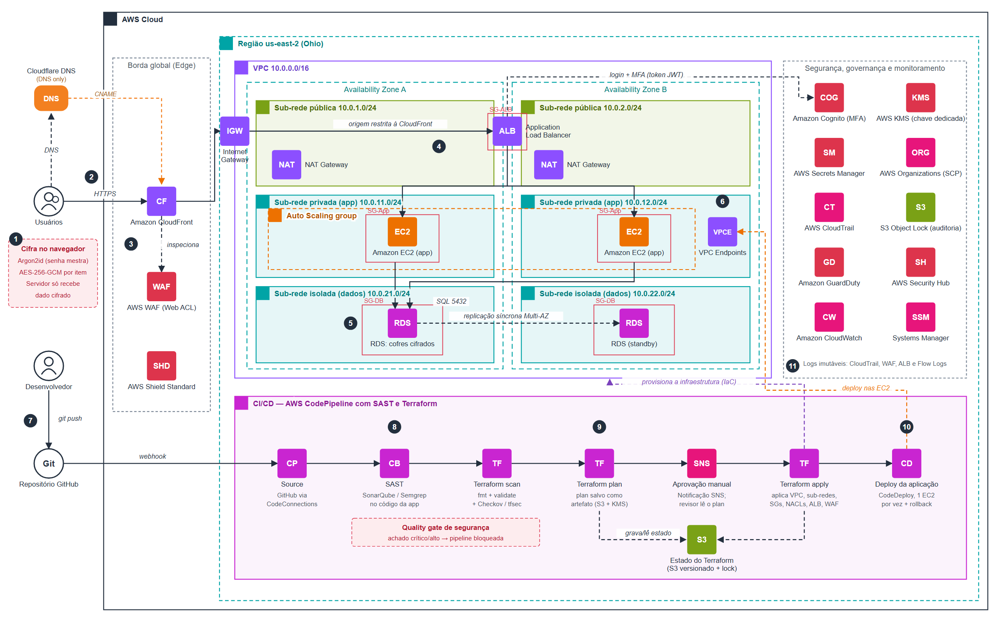
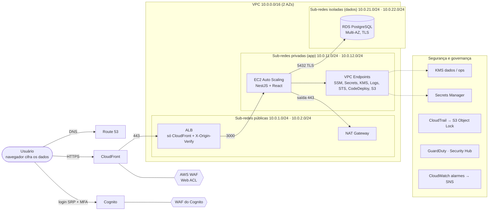
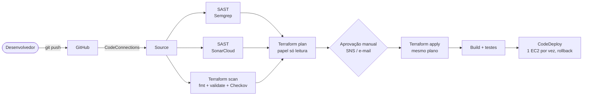

# Arquitetura

O Cofre é um gerenciador de senhas com **conhecimento zero**: toda a criptografia acontece no navegador e a AWS só
guarda texto cifrado. A infraestrutura roda em `sa-east-1` (São Paulo), numa VPC de três camadas em duas zonas de
disponibilidade, com CloudFront + AWS WAF na borda.



> Fonte editável: [`arquitetura-aws.drawio`](arquitetura-aws.drawio).

## Visão simplificada





## Fluxo de uma requisição

1. O navegador deriva as chaves da senha mestra (Argon2id, 64 MiB, 3 iterações) e cifra cada item com AES-256-GCM.
2. O Route 53 resolve o domínio para a CloudFront.
3. A CloudFront termina o TLS e o WAF inspeciona a requisição. O Shield Standard cobre DDoS de camadas 3 e 4.
4. A CloudFront encaminha ao ALB injetando o cabeçalho secreto `X-Origin-Verify`; sem ele o ALB responde 403.
5. O ALB entrega às EC2 (sub-redes privadas), que validam o JWT do Cognito.
6. A API grava só texto cifrado no RDS (sub-redes isoladas, 5432, TLS obrigatório).
7. As EC2 falam com os serviços AWS por VPC Endpoints, sem passar pela internet.
8. O login (SRP + MFA) vai direto ao Cognito, protegido por uma Web ACL própria.

## Modelo de criptografia

```
senha mestra --Argon2id--> chave mestra --HKDF--+--> encKey       (fica no navegador)
                                                +--> authPassword  (vai ao Cognito via SRP)

userKey = 256 bits aleatórios, gerada no navegador
  - cada item: AES-256-GCM com a userKey
  - protectedUserKey         = AES-GCM(encKey, userKey)     -> servidor
  - recoveryProtectedUserKey = AES-GCM(chaveDoKit, userKey) -> servidor
```

O servidor recebe apenas strings `v1.<iv>.<texto cifrado>` e recusa qualquer outra coisa
(`backend/src/common/enc-string.ts`).

## Componentes

| Componente | Arquivo | Decisão de segurança |
|---|---|---|
| CloudFront + WAF | `infra/cdn_waf.tf` | Única porta de entrada da aplicação; ver [waf.md](waf.md) |
| ALB | `infra/alb.tf` | TLS 1.3, 403 por padrão, só encaminha com `X-Origin-Verify`; logs em S3 |
| EC2 / Auto Scaling | `infra/compute.tf` | Sem IP público e sem SSH (Session Manager), IMDSv2, EBS cifrado, IAM mínimo |
| RDS PostgreSQL 16 | `infra/rds.tf` | Sub-rede isolada, `force_ssl`, KMS, senha gerada e rotacionada no Secrets Manager |
| Cognito | `infra/cognito.tf` | MFA obrigatório (TOTP), senha mínima de 32 caracteres (é derivada) |
| KMS | `infra/kms.tf` | Chave de dados e chave de operação; quem administra não decifra |
| Auditoria | `infra/audit.tf` | CloudTrail em S3 com Object Lock; GuardDuty; Security Hub (FSBP) |
| Monitoramento | `infra/monitoring.tf` | Alarmes: política KMS alterada, trilha alterada, segredo lido por humano, uso do root, login sem MFA, SG/NACL alterado fora da pipeline, 5xx no ALB |
| SCP (opcional) | `infra/scp.tf` | Impede desligar auditoria/detecção e burlar Object Lock |

## Divergências conhecidas no diagrama

- O estágio SAST cita "SonarQube / Semgrep": o código usa **Semgrep** e **SonarCloud** (o SonarQube em nuvem), em paralelo.
- O scan da IaC cita "Checkov / tfsec": o código usa só o **Checkov**.
- O diagrama mostra uma chave KMS; o Terraform cria duas (`data` e `ops`).
