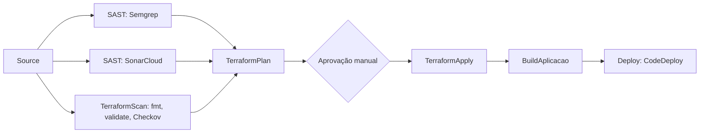

# Pipeline DevSecOps

Todo push na branch configurada (`github_branch`; neste repositório, `master`) dispara uma AWS CodePipeline
(`infra/pipeline.tf`) que só publica o que passa pelos gates de segurança. O GitHub conecta via CodeConnections, sem
chaves de acesso no repositório.



| Estágio | Buildspec | O que faz | Bloqueia quando |
|---|---|---|---|
| Source | — | Lê o GitHub via CodeConnections | — |
| Segurança / SAST | `pipeline/buildspecs/sast.yml` | Semgrep `p/ci`, `p/typescript`, `p/react`, `p/nodejsscan`, `p/jwt`, `p/secrets` em `backend/src` e `frontend/src`; gera `semgrep.sarif` | Achado de severidade ERROR |
| Segurança / SonarCloud | `pipeline/buildspecs/sonar.yml` | SonarScanner (versão fixada, SHA-256 conferido) envia a análise ao SonarCloud; `sonar-gate.sh` espera o processamento e consulta a API | Vulnerabilidade aberta BLOCKER ou CRITICAL |
| Segurança / TerraformScan | `pipeline/buildspecs/tf-scan.yml` | `terraform fmt -check`, `validate` (infra e bootstrap), Checkov com relatório JUnit | Qualquer verificação reprovada |
| TerraformPlan | `pipeline/buildspecs/tf-plan.yml` | `terraform plan -out=tfplan` com papel somente leitura; salva `plan.txt` | Erro no plan |
| Aprovação | — | Notificação SNS por e-mail; revisor lê o plan | Rejeição |
| TerraformApply | `pipeline/buildspecs/tf-apply.yml` | Aplica exatamente o `tfplan` aprovado | Plano desatualizado |
| BuildAplicacao | `pipeline/buildspecs/build.yml` | `npm test` + build do NestJS e do React; monta o pacote | Teste falhando |
| Deploy | `deploy/appspec.yml` | CodeDeploy `OneAtATime` com health check do ALB | Falha → rollback automático |

## SAST: Semgrep e SonarCloud

O enunciado cita o SonarQube. A pipeline roda dois analisadores em paralelo no estágio Seguranca:

- **Semgrep**: roda inteiro dentro do CodeBuild, tem regras para NestJS, React, JWT e segredos e exporta SARIF.
- **SonarCloud**: a versão em nuvem do SonarQube, gratuita para repositório público. Dispensa manter um servidor
  SonarQube. O resultado fica no painel do SonarCloud, com histórico por commit.

### Critério de bloqueio do SonarCloud

`pipeline/buildspecs/sonar-gate.sh` espera o SonarCloud processar a análise e bloqueia a pipeline se houver
vulnerabilidade aberta de severidade BLOCKER ou CRITICAL, o mesmo critério do Semgrep. O status do quality gate e o
número de security hotspots a revisar aparecem no log, mas não bloqueiam. O quality gate padrão (Sonar way) exige 80%
de cobertura de testes em código novo, e o plano gratuito não deixa criar um quality gate próprio.

### Token

O token de análise fica no SSM Parameter Store como `SecureString`, cifrado com a chave KMS `ops`. Só o papel
`cofre-prod-sonar` pode lê-lo. O Terraform cria o parâmetro com um valor provisório e ignora mudanças nele, então o
token real nunca passa pelo estado. O Secrets Manager não foi usado porque `monitoring.tf` alarma qualquer leitura
de segredo feita fora das EC2.

### Configuração (uma vez)

1. Em sonarcloud.io, entre com o GitHub, importe o repositório e anote a chave da organização e do projeto.
2. Em *Administration → Analysis Method*, desligue a *Automatic Analysis*. A análise passa a vir só da pipeline.
3. Em *My Account → Security*, gere um token.
4. Preencha `sonar_organization` e `sonar_project_key` em `infra/env/prod.tfvars` e rode o `terraform apply`.
5. Grave o token:

   ```bash
   aws ssm put-parameter --name /cofre-prod/sonarcloud-token --type SecureString \
     --key-id alias/cofre-prod-ops --overwrite --value <token>
   ```

Com `enable_sonarcloud = false`, o Terraform não cria o estágio, o papel nem o parâmetro.

## Checkov

`.checkov.yaml` define o framework. Resultado atual: 360 verificações aprovadas, 0 reprovadas. As exceções ficam no
próprio recurso com justificativa, por exemplo:

```hcl
#checkov:skip=CKV2_AWS_28:O WAF fica na CloudFront; o ALB só aceita a prefix list da CloudFront e o cabeçalho secreto
```

## Separação de privilégios

| Papel IAM | Uso |
|---|---|
| `cofre-prod-build` | SAST (Semgrep), scan e build da aplicação |
| `cofre-prod-sonar` | SonarCloud: o mesmo do build + leitura do parâmetro do token |
| `cofre-prod-tf-plan` | `ReadOnlyAccess` + leitura do estado |
| `cofre-prod-tf-apply` | Só o estágio de apply, depois da aprovação |
| `cofre-prod-codedeploy` | Deploy nas EC2 |

## Deploy nas EC2

`deploy/scripts/` implementa os hooks do CodeDeploy (`stop`, `before_install`, `after_install`, `start`,
`validate`). Os arquivos da aplicação ficam em `/opt/cofre/app` com dono `root` e grupo `cofre` (750/640).
