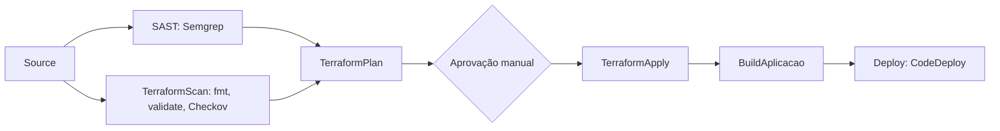

# Pipeline DevSecOps

Todo push na branch configurada (`github_branch`; neste repositório, `master`) dispara uma AWS CodePipeline
(`infra/pipeline.tf`) que só publica o que passa pelos gates de segurança. O GitHub conecta via CodeConnections, sem
chaves de acesso no repositório.



| Estágio | Buildspec | O que faz | Bloqueia quando |
|---|---|---|---|
| Source | — | Lê o GitHub via CodeConnections | — |
| Segurança / SAST | `pipeline/buildspecs/sast.yml` | Semgrep `p/ci`, `p/typescript`, `p/react`, `p/nodejsscan`, `p/jwt`, `p/secrets` em `backend/src` e `frontend/src`; gera `semgrep.sarif` | Achado de severidade ERROR |
| Segurança / TerraformScan | `pipeline/buildspecs/tf-scan.yml` | `terraform fmt -check`, `validate` (infra e bootstrap), Checkov com relatório JUnit | Qualquer verificação reprovada |
| TerraformPlan | `pipeline/buildspecs/tf-plan.yml` | `terraform plan -out=tfplan` com papel somente leitura; salva `plan.txt` | Erro no plan |
| Aprovação | — | Notificação SNS por e-mail; revisor lê o plan | Rejeição |
| TerraformApply | `pipeline/buildspecs/tf-apply.yml` | Aplica exatamente o `tfplan` aprovado | Plano desatualizado |
| BuildAplicacao | `pipeline/buildspecs/build.yml` | `npm test` + build do NestJS e do React; monta o pacote | Teste falhando |
| Deploy | `deploy/appspec.yml` | CodeDeploy `OneAtATime` com health check do ALB | Falha → rollback automático |

## SAST: por que Semgrep

O enunciado cita o SonarQube como exemplo. O projeto usa o Semgrep porque roda dentro do CodeBuild sem servidor
extra, tem regras específicas para NestJS/React/JWT/segredos e exporta SARIF. Se for exigido SonarQube, um estágio
adicional com SonarCloud (gratuito para repositório público) pode rodar em paralelo ao Semgrep.

## Checkov

`.checkov.yaml` define o framework. Resultado atual: 360 verificações aprovadas, 0 reprovadas. As exceções ficam no
próprio recurso com justificativa, por exemplo:

```hcl
#checkov:skip=CKV2_AWS_28:O WAF fica na CloudFront; o ALB só aceita a prefix list da CloudFront e o cabeçalho secreto
```

## Separação de privilégios

| Papel IAM | Uso |
|---|---|
| `cofre-prod-build` | SAST, scan e build da aplicação |
| `cofre-prod-tf-plan` | `ReadOnlyAccess` + leitura do estado |
| `cofre-prod-tf-apply` | Só o estágio de apply, depois da aprovação |
| `cofre-prod-codedeploy` | Deploy nas EC2 |

## Deploy nas EC2

`deploy/scripts/` implementa os hooks do CodeDeploy (`stop`, `before_install`, `after_install`, `start`,
`validate`). Os arquivos da aplicação ficam em `/opt/cofre/app` com dono `root` e grupo `cofre` (750/640).
