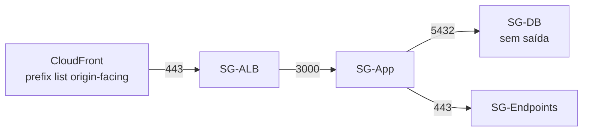

# Rede e isolamento

O banco de dados não tem rota para fora da VPC e só aceita a porta 5432 vinda da camada de aplicação. O isolamento
combina quatro barreiras: tabelas de rota, NACLs, security groups e VPC Endpoints.

## Camadas

| Camada | Sub-redes (AZ A / AZ B) | Rota padrão | Entrada permitida | Recursos |
|---|---|---|---|---|
| Pública | 10.0.1.0/24 · 10.0.2.0/24 | Internet Gateway | HTTPS 443 dos IPs da CloudFront | ALB, NAT Gateway |
| Aplicação | 10.0.11.0/24 · 10.0.12.0/24 | NAT Gateway | `app_port` (3000) só do SG do ALB | EC2, VPC Endpoints de interface |
| Dados | 10.0.21.0/24 · 10.0.22.0/24 | **nenhuma** (só rota local) | 5432 só da camada app | RDS PostgreSQL |

CIDRs calculados em `infra/locals.tf` com `cidrsubnet(var.vpc_cidr, 8, …)`. `map_public_ip_on_launch = false` em
todas as sub-redes.

## Security groups (`infra/security_groups.tf`)

- Regras referenciam outros SGs, não CIDRs: só membros do SG anterior chegam ao próximo.
- Nenhum SG libera entrada para `0.0.0.0/0`.
- O SG do banco não tem regra de saída.
- O SG padrão da VPC (`aws_default_security_group`) fica sem regras, para nada usá-lo por acidente.

## NACLs (`infra/network.tf`)

Segunda barreira, stateless, por sub-rede.

- **Pública**: 443 de qualquer origem (o SG restringe à CloudFront), tráfego interno da VPC e portas efêmeras.
- **Aplicação**: tráfego vindo da VPC e respostas efêmeras.
- **Dados**: entrada 5432 apenas dos dois CIDRs da camada app; saída apenas para esses CIDRs nas portas efêmeras.
- As faixas efêmeras são divididas (1024–3388 e 3390–65535) para não incluir 3389 (RDP).

## VPC Endpoints (`infra/endpoints.tf`)

| Tipo | Serviços | Uso |
|---|---|---|
| Gateway | S3 | Artefatos do deploy |
| Interface | `ssm`, `ssmmessages`, `ec2messages` | Session Manager (acesso sem SSH) |
| Interface | `secretsmanager`, `kms` | Senha do banco |
| Interface | `logs`, `sts` | Logs e credenciais temporárias |
| Interface | `codedeploy`, `codedeploy-commands-secure` | Agente do CodeDeploy |

## Outros controles

- EC2 sem par de chaves e sem IP público; administração via Session Manager.
- IMDSv2 obrigatório com `http_put_response_hop_limit = 1` (mitiga SSRF).
- VPC Flow Logs de todo o tráfego, 365 dias, cifrados com a chave KMS de operação.
- RDS com `publicly_accessible = false`, `rds.force_ssl = 1`, armazenamento cifrado, Multi-AZ.
- Um alarme (`infra/monitoring.tf`) avisa se SG ou NACL for alterado por alguém que não seja o papel `tf-apply`.
